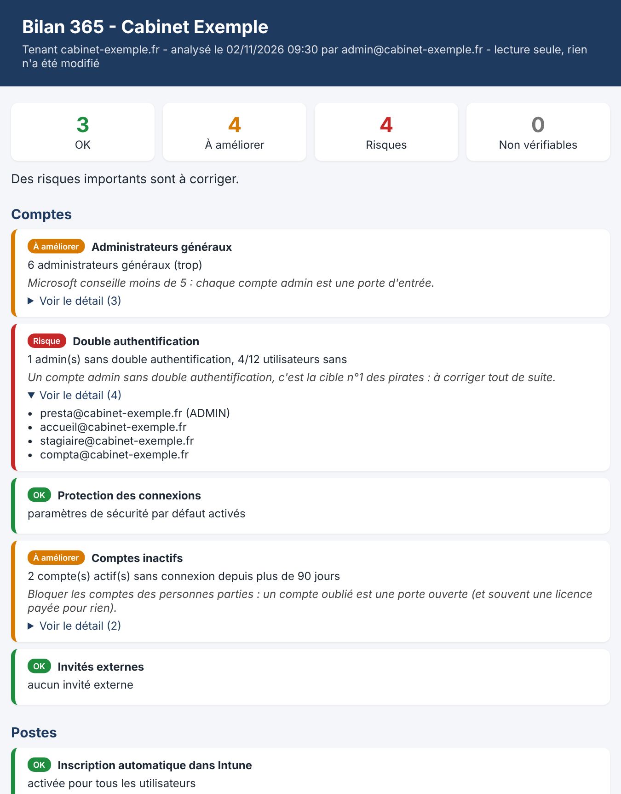

# Bilan 365 — le bilan de sécurité d'un tenant Microsoft 365 en 2 minutes



Script PowerShell **gratuit**, en français, pour les informaticiens qui gèrent des TPE/PME sous Microsoft 365.
Il analyse un tenant et produit un **rapport HTML clair** (vert / orange / rouge), lisible par le client, avec un conseil pour chaque point.

**Lecture seule : rien n'est modifié dans le tenant.** Le script lit, puis écrit uniquement son rapport sur votre Bureau.

## Ce qui est vérifié

| Thème | Contrôles |
|---|---|
| Comptes | Administrateurs généraux (trop ou pas assez), rôles admin permanents ou éligibles (PIM), double authentification (admins compris), mot de passe oublié en libre-service (SSPR : qui y a droit, qui n'a aucune méthode, réglage côté admins), paramètres de sécurité par défaut ou accès conditionnel, comptes inactifs depuis 90 jours, invités externes, usage réel de SMTP AUTH sur 30 jours |
| Postes | Inscription automatique dans Intune, utilisateurs administrateurs de leur PC, LAPS activé et mot de passe sauvegardé pour chaque PC, chiffrement BitLocker, conformité, PC qui ne se synchronisent plus, règle de conformité, mises à jour Windows pilotées |
| Licences | Licences attribuées à personne (les abonnements d'essai sont reconnus et ne sont pas comptés comme payés), licences restées sur des comptes désactivés, licences en dépassement, abonnements expirés (période de grâce) ou suspendus |
| Stockage | Espace utilisé SharePoint (sites et Teams) + OneDrive, au total et par service |

Quand un contrôle ne peut pas être fait, il est marqué « non vérifiable » en précisant pourquoi : **licence manquante** dans le tenant (ex. PIM sans Entra ID P2) ou **droit manquant** pour le compte utilisé. Le bilan ne s'arrête jamais en route.

À savoir : le réglage SMTP AUTH lui-même (par boîte ou pour le tenant) ne se lit qu'avec le module Exchange Online. Le Bilan 365 reste en Graph seul et en lecture seule : il montre donc l'**usage réel** (connexions SMTP authentifiées dans le journal des connexions Entra), avec la **période réellement analysée** : 30 jours avec Entra ID P1/P2, 7 jours seulement sans (dans ce cas, jamais de conclusion « on peut couper »). Les comptes qui ressemblent à un copieur, un scanner ou une application (scan vers mail) sont signalés avec leur adresse IP : c'est le premier truc qui casse quand on coupe.

## Lancer le bilan

**En une commande**, depuis la [PowerShell Gallery](https://www.powershellgallery.com/packages/Bilan-365) :

```powershell
Install-Script -Name Bilan-365 -Scope CurrentUser
Set-ExecutionPolicy -Scope Process Bypass -Force
Bilan-365.ps1
```

Déjà installé ? `Update-Script -Name Bilan-365`

**Ou à la main** : téléchargez **[Bilan-365.ps1 (lien direct)](https://raw.githubusercontent.com/sebastienmastain/bilan-365/main/Bilan-365.ps1)** (clic droit > « Enregistrer le lien sous »), puis :

```powershell
Set-ExecutionPolicy -Scope Process Bypass -Force
.\Bilan-365.ps1
```

⚠️ Ne faites pas « Enregistrer sous » sur la page GitHub du fichier : vous obtiendriez la page web, pas le script (erreurs « Jeton inattendu » au lancement).

Une fenêtre demande le compte administrateur du tenant (ex. `admin@entreprise.fr`), puis Microsoft vous demande de vous connecter et d'accepter les droits. Le rapport s'ouvre tout seul à la fin et reste sur le Bureau. Ctrl+P pour en faire un PDF.

Sans fenêtre : `Bilan-365.ps1 -Compte admin@entreprise.fr`

## Droits demandés (tous en lecture)

`Directory.Read.All`, `AuditLog.Read.All`, `Policy.Read.All`, `Policy.Read.DeviceConfiguration`, `DeviceManagementManagedDevices.Read.All`, `DeviceManagementConfiguration.Read.All`, `DeviceLocalCredential.ReadBasic.All` (sait seulement si un mot de passe LAPS existe, ne le lit pas), `Reports.Read.All` (stockage utilisé), `RoleManagement.Read.Directory` (rôles permanents ou éligibles).

Prérequis : Windows 10 ou 11, PowerShell 5.1, un compte administrateur du tenant. Le module `Microsoft.Graph.Authentication` s'installe tout seul pour votre utilisateur s'il manque. Certains contrôles (dernière connexion, double authentification, SMTP AUTH) demandent une licence Entra ID P1, incluse dans Microsoft 365 Business Premium ; PIM demande Entra ID P2.

## Aller plus loin

Le Bilan 365 fait le tour du tenant en lecture seule. Le **[Pack Scripts M365 & Intune](https://pactiofr.gumroad.com/l/pack-scripts-m365)** (29 €) va plus loin, avec 6 scripts : audit détaillé des licences (économies possibles), audit de sécurité noté sur 100 avec lien direct vers chaque fiche Entra, inventaire du parc Intune, suivi de Windows Update, et des procédures PDF illustrées.

Les autres outils Pactio (bilan de PC, GPO pour TPE, scripts Microsoft 365 et Intune, contrats de maintenance) : **[pactiofr.gumroad.com](https://pactiofr.gumroad.com)**

Un bilan de PC Windows, gratuit lui aussi : **[Bilan express](https://github.com/sebastienmastain/bilan-express)**

## Nouveautés

- **1.3.2** : licences d'essai reconnues. Une licence libre d'un abonnement d'essai n'est plus annoncée « payée » : elle est signalée « essai, gratuit jusqu'au … » et ne met plus le contrôle en orange. Même chose pour les comptes inactifs et les comptes désactivés.
- **1.3.1** : SMTP AUTH : licence Entra ID P1/P2 vérifiée avant de lire le journal, période réellement analysée affichée (7 jours sans P1 = résultat non concluant, jamais un faux « aucune connexion »), comptes de copieur / scanner / application repérés avec leur adresse IP. Merci encore à Ludo1377.
- **1.3.0** : licences sur comptes désactivés, mot de passe oublié en libre-service (SSPR), rôles admin permanents ou éligibles (PIM), usage de SMTP AUTH sur 30 jours, « non vérifiable » qui distingue licence manquante et droit manquant. Merci à Ludo1377 (r/Sysadmin_Fr) pour les idées.
- **1.2.0** : licences en dépassement et abonnements en alerte, stockage SharePoint + OneDrive utilisé. Merci à ppx32 (r/Sysadmin_Fr) pour les idées. Le quota de stockage du tenant n'est pas lisible en lecture seule : à comparer dans le centre d'administration SharePoint.
- **1.1.0** : première version publique.

## Licence

Usage libre, y compris chez vos clients. Redistribution interdite. Fourni en l'état.

Pactio est un nom commercial de Sébastien Mastain EI, administrateur systèmes et réseaux depuis 27 ans (Isère).
